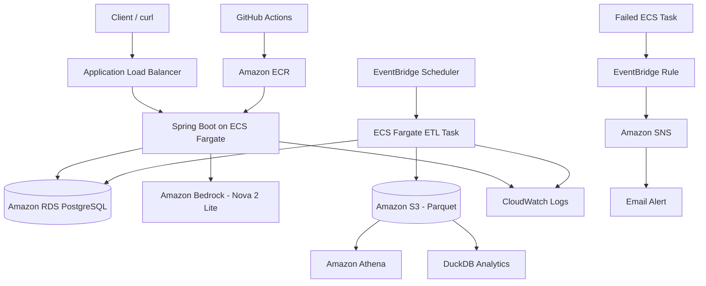

# EnergyPulse

EnergyPulse is a cloud-based energy consumption platform built as a learning and portfolio project focused on **Backend Engineering, Cloud Engineering, and Data Engineering**.

The application provides REST APIs for managing customers and meter readings, processes energy data through an automated ETL pipeline, and uses Amazon Bedrock to generate AI-powered consumption insights.

## Key Features

- REST API built with Java and Spring Boot
- PostgreSQL persistence with Spring Data JPA
- Input validation and centralized exception handling
- Pagination, filtering, and sorting
- Unit and integration testing with JUnit and Mockito
- Database migrations with Flyway
- Dockerized application and PostgreSQL environment
- CI/CD with GitHub Actions
- Deployment to AWS ECS Fargate behind an Application Load Balancer
- PostgreSQL database hosted on Amazon RDS
- Automated Python ETL pipeline
- Parquet storage in Amazon S3
- Analytics with DuckDB and Amazon Athena
- Scheduled batch execution using EventBridge Scheduler
- CloudWatch logging and SNS failure alerts
- AI-powered customer energy insights using Amazon Bedrock and Nova 2 Lite

## Tech Stack

### Backend
- Java 21
- Spring Boot
- Spring Data JPA / Hibernate
- Maven
- REST APIs

### Database
- PostgreSQL
- Flyway

### Testing
- JUnit
- Mockito
- Spring MockMvc

### Data Engineering
- Python
- pandas
- psycopg
- Parquet
- DuckDB
- Amazon Athena

### Cloud / DevOps
- Docker
- Docker Compose
- GitHub Actions
- Amazon ECR
- Amazon ECS Fargate
- Amazon RDS
- Amazon S3
- Amazon CloudWatch
- Amazon EventBridge Scheduler
- Amazon SNS
- AWS Systems Manager Parameter Store

### AI
- Amazon Bedrock
- Amazon Nova 2 Lite

## Architecture



## Main API Endpoints

### Customers

```http
GET /api/customers
GET /api/customers/{customerId}
POST /api/customers
PUT /api/customers/{customerId}
DELETE /api/customers/{customerId}
```

### Meter Readings

```http
POST /api/customers/{customerId}/readings
GET /api/customers/{customerId}/readings
```

### AI Energy Insight

```http
GET /api/customers/{customerId}/insight
```

Example response:

```json
{
  "customerId": "C002",
  "customerName": "Iyed",
  "totalKwh": 53.6,
  "averageKwh": 13.4,
  "maxKwh": 21.4,
  "readingCount": 4,
  "highConsumptionCount": 2,
  "insight": "AI-generated energy consumption insight..."
}
```

The AI endpoint follows this flow:

```text
PostgreSQL data
→ Java calculates energy metrics
→ Amazon Bedrock / Nova 2 Lite
→ AI-generated explanation
→ JSON response
```

## Data Pipeline

EnergyPulse includes a Python ETL pipeline for processing customer energy-consumption data.

The pipeline follows this flow:

```text
PostgreSQL
→ psycopg
→ pandas
→ customer aggregation
→ Parquet
→ Amazon S3
```

The pipeline calculates:

- total energy consumption per customer
- average consumption
- maximum consumption

The generated Parquet file is stored in S3 using date-based partitions:

```text
customer-summaries/
└── extraction_date=YYYY-MM-DD/
    └── customer_summary.parquet
```

The data can then be queried with:

- DuckDB
- Amazon Athena

The pipeline is containerized and runs as an ECS Fargate batch task.

Amazon EventBridge Scheduler launches the task automatically every day.

```text
EventBridge Scheduler
        ↓
ECS Fargate ETL Task
        ↓
Amazon RDS PostgreSQL
        ↓
Python / pandas
        ↓
Parquet
        ↓
Amazon S3
        ↓
Athena / DuckDB
```

Pipeline output and errors are sent to CloudWatch Logs.

Failed ECS tasks are detected by an EventBridge rule and forwarded to Amazon SNS, which sends an email alert.

## CI/CD

The project uses GitHub Actions for automated testing and deployment.

### Pull requests

```text
Pull Request
→ Maven tests
```

### Push to main

```text
git push
→ Maven tests
→ AWS authentication with OIDC
→ Docker image build
→ Push image to Amazon ECR
→ Render new ECS task definition
→ Deploy new revision to ECS Fargate
→ Wait for service stability
```

Docker images use immutable tags based on the Git commit:

```text
github-sha + workflow run attempt
```

AWS authentication from GitHub uses OIDC, so long-lived AWS access keys are not stored in GitHub.

## AI Energy Insights

EnergyPulse provides an AI-powered endpoint:

```http
GET /api/customers/{customerId}/insight
```

The application does not ask the AI model to calculate important values.

Instead:

```text
PostgreSQL
→ Java calculates the metrics
→ Amazon Bedrock receives those metrics
→ Nova 2 Lite generates a human-readable explanation
```

This helps keep numerical calculations deterministic while using AI only for natural-language interpretation.

Example calculated metrics include:

- total consumption
- average consumption
- maximum consumption
- number of readings
- number of high-consumption readings

The endpoint includes error handling for:

- `404 Not Found` when the customer does not exist
- `503 Service Unavailable` when the AI service cannot be reached

## Testing

The project contains several levels of automated tests.

### Unit Tests

JUnit and Mockito are used to test service logic in isolation.

Examples include:

- customer business logic
- meter-reading logic
- missing-customer handling
- Bedrock failure handling

### Controller Tests

Spring MockMvc is used to test HTTP endpoints without starting a real HTTP server.

### Repository Tests

Repository integration tests verify database queries and persistence behavior.

### API Integration Tests

Spring Boot integration tests verify how multiple application layers work together.

Run the complete test suite with:

```bash
mvn test
```

## Running Locally

### Requirements

Install:

- Java 21
- Maven
- Docker
- Docker Compose
- AWS CLI if you want to test the Bedrock feature locally

### Run with Docker Compose

Set the PostgreSQL password:

```bash
export DB_PASSWORD=your_password
```

Start the application and PostgreSQL:

```bash
docker compose up --build
```

The API is then available at:

```text
http://localhost:8080
```

### Local Development with Amazon Bedrock

For local development of the AI endpoint, authenticate with AWS:

```bash
aws login --profile <your-profile> --region eu-north-1
```

Start only PostgreSQL:

```bash
docker compose up -d db
```

Then start Spring Boot from your machine:

```bash
DB_PASSWORD=your_password AWS_PROFILE=<your-profile> mvn spring-boot:run
```

The application can then use the local database and your temporary AWS credentials to call Amazon Bedrock.

## Security

EnergyPulse avoids storing sensitive credentials directly in source code.

The project uses:

- AWS IAM roles for ECS workloads
- GitHub OIDC for CI/CD authentication
- AWS Systems Manager Parameter Store for the database password
- private Amazon S3 storage
- security groups controlling communication between ALB, ECS, and RDS

The Spring Boot application and the ETL pipeline use separate IAM task roles following the principle of least privilege.

## What I Learned

EnergyPulse was built as a practical learning project to understand how a backend application moves from local development to a cloud-based production-style architecture.

Through the project I practiced:

### Backend Engineering

- building REST APIs with Spring Boot
- separating controller, service, and repository layers
- dependency injection
- DTOs and validation
- exception handling
- pagination, filtering, and sorting
- transactions
- Java Streams
- unit and integration testing

### Databases

- PostgreSQL
- SQL queries
- indexes
- relational data modeling
- database migrations with Flyway

### DevOps

- Git and GitHub
- Maven
- Docker
- Docker Compose
- CI/CD with GitHub Actions
- immutable Docker image tags

### Cloud Engineering

- IAM roles and permissions
- Amazon ECR
- Amazon ECS Fargate
- Application Load Balancer
- Amazon RDS
- security groups
- Parameter Store
- CloudWatch
- EventBridge
- SNS
- AWS OIDC authentication

### Data Engineering

- ETL pipelines
- Python and pandas
- PostgreSQL extraction
- Parquet
- S3 data storage
- Hive-style partitions
- DuckDB
- Athena
- SQL window functions
- scheduled batch processing
- pipeline monitoring and failure alerts

### AI Integration

- Amazon Bedrock
- Amazon Nova 2 Lite
- AWS SDK for Java
- building prompts from structured application data
- separating deterministic calculations from AI-generated explanations

## Project Status

EnergyPulse currently includes:

```text
Backend API            ✅
PostgreSQL              ✅
Automated tests         ✅
Flyway migrations       ✅
Docker                  ✅
CI/CD                   ✅
AWS deployment          ✅
RDS                     ✅
Automated ETL pipeline  ✅
S3 / Parquet            ✅
Athena / DuckDB         ✅
Monitoring / alerts     ✅
AI integration          ✅
```

EnergyPulse is a completed portfolio project demonstrating backend, cloud, data engineering, CI/CD, monitoring, and AI integration.